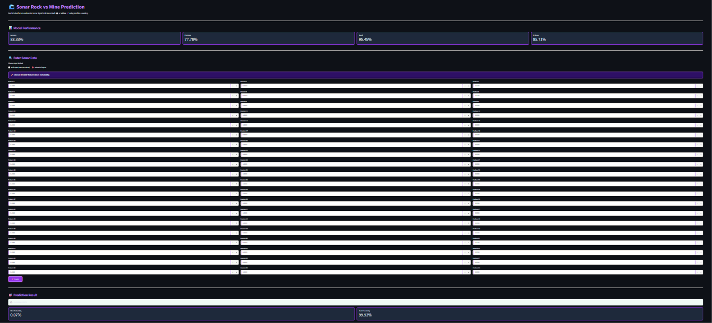
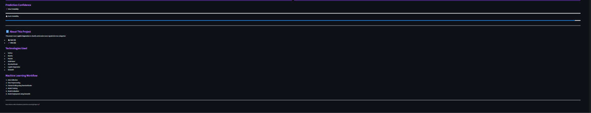

# 🔊 Sonar Rock vs Mine Prediction

An End-to-End Machine Learning project that predicts whether an underwater object is a **Rock or a Mine** using sonar signal data.

## 🌐 Live Demo

🚀 **Try the application online!**

[🔊 Click Here – Sonar Rock vs Mine Prediction](https://sonar-rock-mine-prediction-8hr3jv4gixzqfketvkrgut.streamlit.app/)

## 📌 Project Overview

This project uses Machine Learning to classify underwater objects based on sonar signals.

The model analyzes 60 sonar signal features and predicts whether the detected object is:

- 🪨 Rock (R)
- 💣 Mine (M)

A Logistic Regression algorithm is used to train the classification model.

## ✨ Features

- Predicts Rock or Mine using 60 input features.
- Displays prediction confidence.
- Shows Rock and Mine probabilities.
- Interactive Streamlit web application.
- Model performance dashboard.
- Confusion matrix visualization.

## 🖥️ Application Screenshots

### Sonar Prediction Dashboard



### Prediction Result



## 🧠 Machine Learning Model

**Algorithm:** Logistic Regression

**Dataset:** UCI Sonar Dataset

**Input Features:** 60

**Output Classes:** 2 (Rock and Mine)

## 📊 Model Performance

The model was evaluated using a test dataset of 42 samples.

| Metric | Score |
|---|---:|
| Accuracy | 80.95% |
| Precision (Mine) | 76.92% |
| Recall (Mine) | 90.91% |
| F1 Score (Mine) | 83.33% |

### Confusion Matrix

```text
[[20  2]
 [ 6 14]]
```

These results represent the evaluation on the selected test split, not a guarantee of real-world performance.

## 🛠️ Technologies Used

- Python
- NumPy
- Pandas
- Scikit-learn
- Joblib
- Streamlit
- Git and GitHub

## 📂 Project Structure

```text
Sonar_Prediction/
│
├── app.py
├── sonar_model_bundle.pkl
├── requirements.txt
├── README.md
├── .gitignore
│
└── screenshots/
    ├── sonar-dashboard.png
    └── prediction-result.png
```

## ⚙️ Installation and Setup

### 1. Clone the repository

```bash
git clone https://github.com/Athsal01/sonar-rock-mine-prediction.git
```

### 2. Navigate to the project folder

```bash
cd sonar-rock-mine-prediction
```

### 3. Create a virtual environment

```bash
python -m venv ml_env
```

### 4. Activate the environment

Windows PowerShell:

```bash
.\ml_env\Scripts\Activate.ps1
```

### 5. Install dependencies

```bash
pip install -r requirements.txt
```

### 6. Run the application

```bash
python -m streamlit run app.py
```

The application will open in your browser.

## 🔄 Project Workflow

1. Load the Sonar dataset.
2. Separate input features and target labels.
3. Split the dataset into training and testing sets.
4. Train the Logistic Regression model.
5. Evaluate model performance.
6. Save the trained model using Joblib.
7. Build an interactive Streamlit application.
8. Deploy the application using Streamlit Community Cloud.

## 🎯 Learning Outcomes

Through this project, I learned:

- Machine Learning classification.
- Data preprocessing and model training.
- Model evaluation using classification metrics.
- Model serialization using Joblib.
- Building interactive applications using Streamlit.
- Version control using Git and GitHub.
- Deploying Machine Learning applications to the cloud.

## 👨‍💻 Author

**Athsal**

GitHub: [@Athsal01](https://github.com/Athsal01)

---

⭐ If you find this project interesting, consider giving this repository a star!
